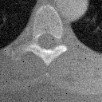
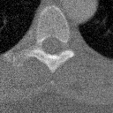
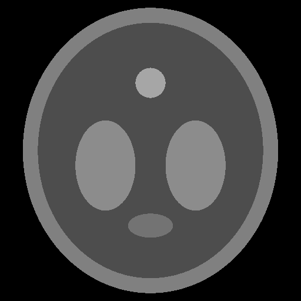
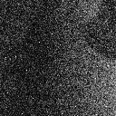
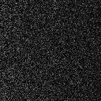
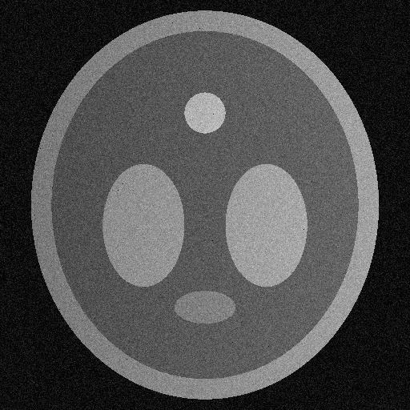
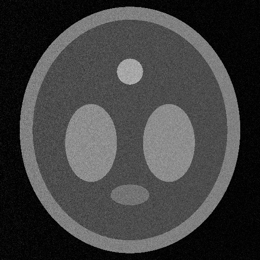
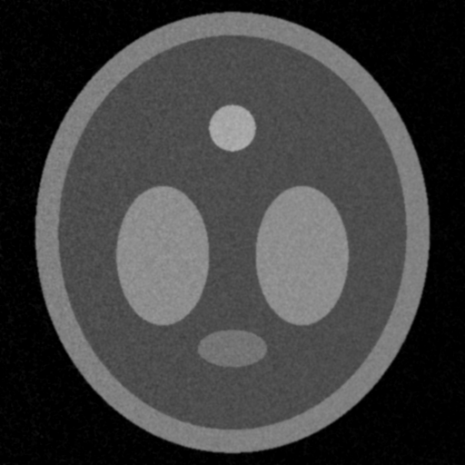
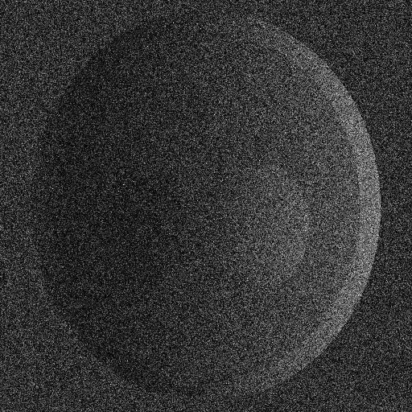
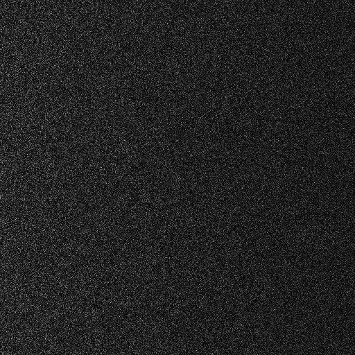

# MiniCT-Lite — C++ Medical Image Processing Pipeline

MiniCT-Lite is an educational C++17 project that loads a grayscale CT image in DICOM format or generates a synthetic phantom, simulates detector imperfections (offset, uneven gain, noise, and dead pixels), applies correction and denoising algorithms implemented in C++, and evaluates the results using image-quality metrics.

| Simulated raw CT | After correction | After Gaussian denoising |
|:---:|:---:|:---:|
|  |  |  |

> Educational project, not a medical device. It must not be used for diagnosis or patient management.

The README includes visual results for both the sample CT image and the synthetic phantom. Run the program in each mode and commit the generated PNGs to the matching `results/` folders for them to display on GitHub.


## 1. Running the Project

### Requirements

- C++17-compatible compiler
- CMake 3.14 or newer
- DCMTK
- Internet connection during the initial configuration to download the sample DICOM image and required third-party libraries

### Install dependencies

**macOS**

```bash
brew install cmake dcmtk
```

**Ubuntu / WSL**

```bash
sudo apt update
sudo apt install build-essential cmake libdcmtk-dev
```

### Build and test

Run the following commands from the project root:

```bash
cmake -S . -B build
cmake --build build
ctest --test-dir build --output-on-failure
```

During configuration, CMake downloads the sample CT image from the [pydicom project's test files](https://github.com/pydicom/pydicom/blob/main/src/pydicom/data/test_files/CT_small.dcm) into `build/sample_CT_small.dcm`, if it is not already present.

### Run with the sample CT image

```bash
./build/minict_cli build/sample_CT_small.dcm
```

You can also supply another compatible grayscale DICOM file:

```bash
./build/minict_cli /path/to/your_image.dcm
```

The reader supports 8-bit and 16-bit grayscale pixel data, uncompressed data and supported JPEG-compressed data. For multi-frame DICOM files, only the first frame is processed.

**Run without a DICOM argument**

```bash
./build/minict_cli
```

This generates a synthetic image using the built-in phantom instead of loading a real CT image.

The program writes six PNG images to the current working directory:

| File | Contents |
|---|---|
| `1_truth.png` | Reference image after windowing |
| `2_raw.png` | Image after simulated detector imperfections |
| `3_corrected.png` | Image after flat-field correction and dead-pixel repair |
| `4_denoised.png` | Corrected image after Gaussian filtering |
| `5_error_raw.png` | Absolute error between the reference and raw simulated image |
| `6_error_corrected.png` | Absolute error between the reference and corrected image |

These files are visualizations of the processing stages. They are not lossless representations of the original floating-point image data.

## 2. Project Structure

```text
MiniCT-Lite/
├── CMakeLists.txt
├── results/
│   ├── sample-results/
│   └── phantom-results/
│       
├── include/
│   └── minict/
│       ├── image.hpp
│       ├── dicom.hpp
│       ├── phantom.hpp
│       ├── corrections.hpp
│       ├── filters.hpp
│       ├── metrics.hpp
│       └── png.hpp
├── src/
│   ├── image.cpp
│   ├── dicom.cpp
│   ├── phantom.cpp
│   ├── corrections.cpp
│   ├── filters.cpp
│   ├── metrics.cpp
│   ├── png.cpp
│   └── main.cpp
└── tests/

```

The project separates image representation, file I/O, corrections, filtering, and quality evaluation into independent components.

- **`image`** — a lightweight grayscale image container backed by a one-dimensional `std::vector<float>`.
- **`dicom`** — loads DICOM pixel data and applies rescale and windowing operations.
- **`phantom`** — generates a synthetic image and simulates detector imperfections.
- **`corrections`** — implements offset correction, flat-field correction, dead-pixel detection, and repair.
- **`filters`** — implements mean, median, and Gaussian filters.
- **`metrics`** — calculates mean squared error and peak signal-to-noise ratio.
- **`png`** — converts floating-point images to 8-bit grayscale PNG files.
- **`main`** — orchestrates the processing pipeline, reports metrics, and benchmarks Gaussian implementations.
- **`tests`** — contains GoogleTest unit and pipeline tests.

## 3. Input Images and Reference Data

The project supports two input modes.

### 3.1 Sample CT image

By default, the build configuration downloads `CT_small.dcm` from the pydicom project's public test files.


This is a small test image intended for DICOM development and testing, not a complete CT dataset or a collection of patient scans.

The DICOM reader extracts the pixel data and applies the rescale slope and intercept:

$$
I_{\mathrm{rescaled}} = I_{\mathrm{stored}} \cdot S + B
$$

where $S$ is the rescale slope and $B$ is the rescale intercept.

For CT images, the resulting values may represent Hounsfield units, depending on the modality and the image's metadata.

The program then applies windowing to map the values to a normalized display range:

$$
I_{\mathrm{display}} =
\operatorname{clamp}\left(
\frac{I_{\mathrm{rescaled}}-(C-W/2)}{W},
0,1
\right)
$$

where $C$ is the window center and $W$  is the window width.

If valid window settings are unavailable, the program derives a window from the minimum and maximum image values.

This is a simplified linear windowing implementation for visualization; it does not implement every detail of the DICOM VOI LUT specification.

### 3.2 Synthetic phantom

When no input file is supplied, the program generates a 512 × 512 synthetic phantom using overlapping ellipses with different intensity values.

The phantom provides a controlled reference image for testing the correction and filtering algorithms. It is not a realistic anatomical model and does not simulate CT acquisition or reconstruction physics.



### What does "truth" mean here?

The variable `truth` refers to the reference image used by the simulation.

When a DICOM file is supplied, `truth` is the loaded image after rescaling and windowing. When no file is supplied, `truth` is the generated phantom.

The program introduces artificial detector imperfections into this reference and compares the processed results against it. Therefore, `truth` is a **known reference for this experiment**, not independently validated clinical ground truth.

## 4. Processing Pipeline

The pipeline consists of detector simulation, correction, filtering, and quantitative evaluation.

### 4.1 Detector simulation

The program simulates three main types of detector imperfections: offset, spatially varying gain, and random noise. It also introduces dead pixels.

The simplified detector model is:

$$
R(x,y) = T(x,y)\,G(x,y) + D + N(x,y)
$$

where:

- $T(x,y)$ is the reference image,
- $G(x,y)$ is the detector gain, varying horizontally across the image,
- $D$ is a constant detector offset,
- $N(x,y)$ is additive Gaussian noise,
- $R(x,y)$ is the simulated raw image.

The gain varies from approximately 0.8 to 1.2 across the image, and the constant offset is 0.05. Gaussian noise is generated using a seeded random-number generator.

Dead pixels are simulated by setting their raw and flat-field measurements to zero.

The fixed random seed makes the simulation reproducible in the same environment. Exact random sequences are not guaranteed to be identical across all standard-library implementations.

### 4.2 Offset correction

Offset correction subtracts a dark-field image from the raw image:

$$
I_{\mathrm{offset}}(x,y) = R(x,y) - D_{\mathrm{img}}(x,y)
$$

where $D_{\mathrm{img}}$ is the measured dark-field image.

This removes the modeled detector offset when the dark-field measurement correctly represents that offset.

### 4.3 Flat-field correction

Flat-field correction compensates for spatial variations in detector gain:

$$
I_{\mathrm{flat}}(x,y) = \frac{R(x,y) - D_{\mathrm{img}}(x,y)}{F(x,y) - D_{\mathrm{img}}(x,y)}
$$

where $F(x,y)$  is the flat-field measurement.

In this project, the flat-field image represents a uniform input measured with the same detector gain and offset. Under the idealized model, the correction compensates for the varying gain and recovers the reference intensity, apart from noise and defective pixels.

The implementation guards against a denominator close to zero. Such measurements should be treated as invalid rather than interpreted as reliable image values.

### 4.4 Dead-pixel detection and repair

Dead pixels are identified using the difference between the flat-field and dark-field measurements. A pixel is considered dead if its response $F - D_{\mathrm{img}}$ is below the threshold.

Each detected pixel is then replaced by the average of its valid, non-defective neighbors in a 3 × 3 neighborhood:

$$
I_{\mathrm{repaired}}(x,y) = \frac{1}{|\mathcal{N}|} \sum_{(i,j) \in \mathcal{N}} I(i,j)
$$

where $\mathcal{N}$ contains the available neighboring pixels, excluding the defective pixel and other pixels marked as defective.

This is a simple local repair method. It does not reconstruct the true value of a defective pixel, particularly near edges or in regions with fine structures.

### 4.5 Image filtering

The project implements three spatial filters to explore smoothing and noise reduction.

**Mean filter**

The mean filter replaces each pixel with the average of its neighborhood:

$$
I_{\mathrm{mean}}(x,y) = \frac{1}{k^2} \sum_{i=-r}^{r} \sum_{j=-r}^{r} I(x+i,\ y+j)
$$

where $k = 2r + 1$ is the odd kernel size.

It is simple but can blur edges and small structures.

**Median filter**

The median filter replaces each pixel with the median of the neighborhood values:

$$
I_{\mathrm{median}}(x,y) = \operatorname{median}\{\, I(x+i,\ y+j) \,\}
$$

It is particularly useful for isolated extreme-value noise, such as salt-and-pepper noise, while often preserving edges better than a mean filter.

**Gaussian filter**

The Gaussian filter computes a weighted neighborhood average using Gaussian weights:

$$
G(i,j) = \frac{1}{2\pi\sigma^2} \exp\left( -\frac{i^2 + j^2}{2\sigma^2} \right)
$$

The kernel is truncated to a finite neighborhood and normalized so its weights sum to one.

Two implementations are provided:

- **Naive 2D Gaussian:** applies the full two-dimensional kernel directly.
- **Separable Gaussian:** applies a horizontal one-dimensional Gaussian filter followed by a vertical one-dimensional filter.

Because a Gaussian kernel is separable, the two approaches are mathematically equivalent apart from floating-point rounding.

For an image with $N$ pixels and a kernel width $k$, the naive implementation has computational complexity $O(Nk^2)$ , whereas the separable implementation has complexity $O(Nk)$.

The separable implementation is therefore expected to be more efficient for larger kernels.

The current command-line pipeline uses the separable Gaussian filter with $\sigma = 1.0$  after dead-pixel repair. The mean and median filters are available for separate experiments.

All filters use clamped boundary handling, which extends the nearest edge value beyond the image boundary.

## 5. Quality Metrics

The program evaluates intermediate results against the reference image using mean squared error (MSE) and peak signal-to-noise ratio (PSNR).

### Mean squared error

$$
\operatorname{MSE}(T,I) = \frac{1}{N} \sum_{i=1}^{N} (T_i - I_i)^2
$$

where $T$ is the reference image, $I$ is the processed image, and $N$ is the number of pixels. Lower MSE means a smaller average squared difference from the reference.

### Peak signal-to-noise ratio

$$
\operatorname{PSNR}(T,I) = 10 \log_{10}\left( \frac{P^2}{\operatorname{MSE}(T,I)} \right)
$$

where $P$ is the peak value of the image's intensity scale. The program uses $P = 1$, consistent with the normalized range 0 to 1. Higher PSNR means lower pixel-wise error relative to the reference. For identical images the PSNR is infinite.


PSNR does not fully characterize image quality. A filter can increase PSNR while blurring small structures or reducing edge sharpness. The results should therefore be interpreted alongside visual inspection and the known limitations of the simulation.

## 6. Results and Performance

The following measurements were recorded from a run using the 128 × 128 `CT_small.dcm` sample image. PSNR was measured at each pipeline stage against the windowed reference image. Results depend on the input, simulation, compiler, and machine.

### PSNR results

<details>
<summary>Sample CT image (128 × 128)</summary>

| Processing stage | PSNR (dB) |
|---|---:|
| Raw simulated image | 21.63 |
| After offset correction | 23.45 |
| After flat-field correction | 25.41 |
| After dead-pixel repair | 25.80 |
| After Gaussian filtering | 34.06 |

</details>

In this run, PSNR increased at each processing stage, from 21.63 dB for the raw simulated image to 34.06 dB after Gaussian filtering. These measurements describe this particular image and simulation; they do not guarantee improvement for every input.

The following phantom PSNR values were recorded in a separate run on the 512 × 512 synthetic image. They are shown separately because they are not from the latest CT benchmark run.

<details>
<summary>Synthetic phantom (512 × 512)</summary>

| Processing stage | Phantom PSNR (dB) |
|---|---:|
| Raw simulated image | 22.38 |
| After offset correction | 24.82 |
| After flat-field correction | 25.81 |
| After dead-pixel repair | 25.83 |
| After Gaussian filtering | 32.16 |

</details>

### Gaussian filter performance

The naive 2D Gaussian implementation was compared with the separable implementation on a 128 × 128 image using $\sigma = 2.0$ The reported execution times are the median of 10 runs, after a warm-up run.

<details>
<summary>Sample CT image (128 × 128)</summary>

| Implementation | Median time (ms) |
|---|---:|
| Naive 2D Gaussian | 5.38 ms |
| Separable Gaussian | 0.60 ms |
| Speedup | 9.0× |

Largest pixel difference between the two versions: `4.8e-07`

</details>

<details>
<summary>Synthetic phantom (512 × 512)</summary>

| Implementation | Median time (ms) |
|---|---:|
| Naive 2D Gaussian | 59.01 ms |
| Separable Gaussian | 8.89 ms |
| Speedup | 6.6× |

Largest pixel difference between the two versions: `5.4e-07`

</details>

The speedup is calculated as:

$$
\text{Speedup} = \frac{t_{\mathrm{naive}}}{t_{\mathrm{separable}}}
$$

For an image with $N$ pixels and a kernel width $k$, the naive implementation has computational complexity $O(Nk^2)$, compared with $O(Nk)$ for the separable implementation. 

### Visual comparison

The generated PNGs show the reference, simulated detector output, corrected image, and filtered result. Error maps are also saved for the sample CT run.

<details>
<summary>Sample CT image</summary>

| Reference | Raw | Corrected | Denoised |
|:---:|:---:|:---:|:---:|
|  |  |  |  |

Error images (brighter = larger difference from the reference). The raw error is larger on the right side because of the gain gradient; after correction only noise remains:

| Raw error | Corrected error |
|:---:|:---:|
|  |  |

</details>

<details>
<summary>Synthetic phantom</summary>

| Reference | Raw | Corrected | Denoised |
|:---:|:---:|:---:|:---:|
|  |  |  |  |

| Raw error | Corrected error |
|:---:|:---:|
|  |  |

</details>


The expected effects are reduced offset and gain variation after correction, repaired defective pixels, and smoother output after Gaussian filtering. PSNR and visual appearance should be interpreted together: smoothing can reduce pixel-wise error while also blurring small structures.

## 7. Requirements and Testing

The project includes GoogleTest-based unit and pipeline tests. On macOS, the project built successfully with Apple Clang 17.0.0.17000404 and CMake 4.4.5. The test suite completed with **47 of 47 tests passing** in **0.77 seconds**.

The tests cover image storage and indexing, DICOM loading and windowing, detector corrections, filtering, quality metrics, PNG output, simulation parameters, and pipeline behavior. Representative tests include:

| Requirement | Test |
|---|---|
| DICOM image size and rescale slope/intercept | `Dicom.ReadsSizeAndAppliesRescale` |
| Read window center and width | `Dicom.ReadsWindowFromFile` |
| Preserve signed and unsigned pixel values | `Dicom.SignedPixelsKeepTheirSign`, `Dicom.UnsignedPixelsStayPositive` |
| Reject missing or invalid DICOM files | `Dicom.FileWithoutDicmMarkerThrows`, `Dicom.MissingFileThrows` |
| Map the selected window to the normalized range | `Window.MapsWindowRangeToZeroOne` |
| Subtract the dark-field offset | `Corrections.OffsetIsSubtracted` |
| Compensate for detector gain variation | `Corrections.FlatFieldRemovesGain` |
| Replace a dead pixel using neighboring values | `Corrections.DeadPixelIsReplacedByNeighbourAverage` |
| Remove an isolated spike with median filtering | `Filters.MedianRemovesIsolatedSpike` |
| Compare naive and separable Gaussian outputs | `Filters.SeparableMatchesNaive` |
| Check deterministic simulation for a fixed seed | `Simulation.SameSeedGivesSameImage` |
| Evaluate the pipeline's behavior on a defined test case | `Pipeline.EachStepImprovesQuality` |

Run the test suite with:

```bash
ctest --test-dir build --output-on-failure
```

An optional AddressSanitizer/UndefinedBehaviorSanitizer build can help detect memory errors and undefined behavior:

```bash
cmake -S . -B build-san -DCMAKE_BUILD_TYPE=Debug \
  -DCMAKE_CXX_FLAGS="-fsanitize=address,undefined -fno-omit-frame-pointer"
cmake --build build-san
ctest --test-dir build-san --output-on-failure
```

Passing tests verifies the tested cases; it does not establish complete DICOM conformance or clinical validity. In particular, improvement at every stage is only expected for a specifically defined test image and simulation, not as a universal property of image processing.

## 8. Limitations

MiniCT-Lite is deliberately small and simplified. Its current limitations include:

- **Limited DICOM support:** only grayscale 8-bit and 16-bit pixel data are handled. Multi-frame files are reduced to the first frame, and only supported JPEG-compressed and uncompressed representations are covered.
- **Simplified DICOM interpretation:** required metadata and pixel-format combinations are not comprehensively validated. Windowing is a simplified linear transformation rather than a complete implementation of all DICOM VOI LUT behavior.
- **Synthetic detector model:** the simulation uses a constant offset, horizontally varying gain, additive Gaussian noise, and randomly selected dead pixels. It does not model the full physics of CT acquisition or detector behavior.
- **Reference-image evaluation:** the supplied CT image is used as the reference for an artificial corruption experiment. It is not independent ground truth for a reconstruction algorithm.
- **Basic defect repair:** neighboring-pixel averaging may blur edges and cannot reliably recover missing anatomical detail.
- **Basic filtering:** the filters do not adapt to local image structure, and smoothing may remove diagnostically relevant detail.
- **Limited quality evaluation:** MSE and PSNR do not fully capture perceptual or clinical image quality.
- **Preliminary benchmarking:** timings are based on repeated runs on small images and may still be affected by system load, compiler settings, and other factors.
- **Educational scope:** the software is not validated for clinical use and should not be used to support diagnosis or patient management.


